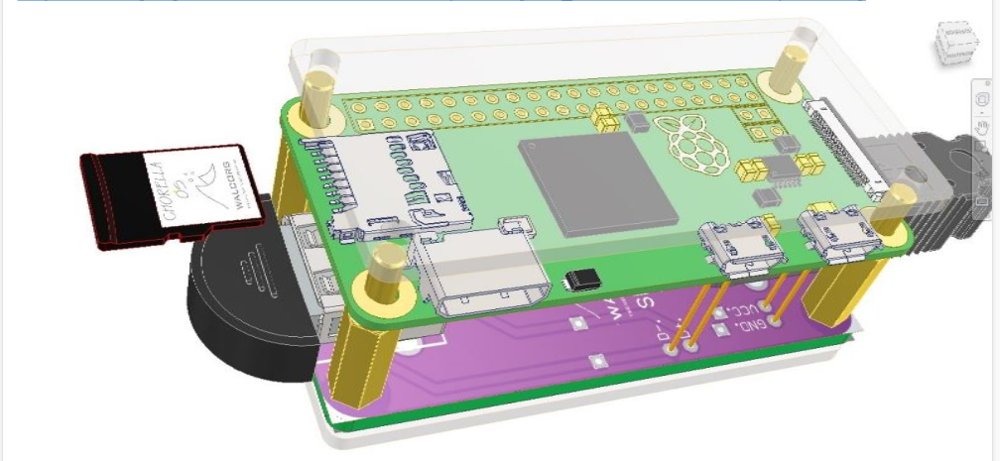
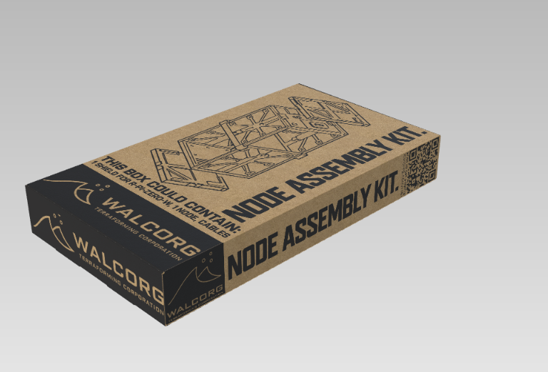

# node-routine

Unified Arduino Nano firmware for the **WALCORG TERRAFORMING CORP.** **v4.5 photobioreactor node**: LED control (TLC59401), 16-channel light sensing, UVC disinfection and an I2C slave protocol for Clorela-OS.

<p align="center">
  
</p>

## Contents

| Path | Description |
|---|---|
| [`firmware/walcorg_node_v45/walcorg_node_v45.ino`](firmware/walcorg_node_v45/walcorg_node_v45.ino) | Single sketch for the Arduino Nano (ATmega328P) on the rigid PCB |
| [`host/node_i2c_example.py`](host/node_i2c_example.py) | Python I2C master example for the Raspberry Pi Zero W (shield) |
| [`docs/img/`](docs/img) | Images of the node, flex PCB, rigid PCB, shield and kit box |

## Architecture

```
Raspberry Pi Zero W + shield (Clorela-OS)
        │  USB-B: +5 V (500 mA PTC) + I2C 100 kHz (SDA = D-, SCL = D+)
        ▼
Rigid PCB v4.5 ── Arduino Nano (I2C slave 0x10–0x13)
        │            ├─ TLC59401: 12 visible LEDs + 4 UVC LEDs
        │            ├─ CD74HC4067: 16 light sensors → A0
        │            └─ MT3608: +V_UV (9 V) for the UVC LEDs
        ▼  J1 / J2 (40-pin FPC, 0.5 mm)
Flex PCB ── LEDs, sensors and ID EEPROM on the walls of the 1 L cube
```

| | |
|---|---|
|  |  |
| Flex PCB: FPC tails that plug into J1 and J2 | Rigid PCB that carries the Arduino Nano |
|  |  |
| Raspberry Pi Zero W shield that drives one or more nodes | Retail box for the node assembly kit |

## Channel map

| TLC59401 | Use | CD74HC4067 | Use |
|---|---|---|---|
| 0–7 | Data LEDs (1 bit each, LSB = channel 0) | 0–7 | SENS_B0–B7, backscatter (J1) |
| 8–11 | Calibration LEDs | 8–15 | SENS_T0–T7, transmission (J2) |
| 12–15 | UVC LEDs (275 nm) | | |

## Build and upload

1. Arduino IDE, board **Arduino Nano**, processor **ATmega328P**.
2. Install the **Tlc5940** library (Library Manager, or [PaulStoffregen/Tlc5940](https://github.com/PaulStoffregen/Tlc5940)). Its default configuration matches this board's pinout.
3. If your Nano uses the old bootloader ("ATmega328P (Old Bootloader)"), set `USE_WATCHDOG 0` in the sketch.

Memory usage: ~8 KB flash (25 %) and ~1 KB RAM (51 %).

## I2C protocol

Address: `0x10 + ADDR1·2 + ADDR0` (solder jumpers SJ1/SJ2; closed = 1).

- The master writes `[command, arguments…]` (32 bytes max).
- A read after any command returns **8 status bytes**: `[state, flags, last_cmd, error, fw_version, uv_sec_L, uv_sec_H, address]`.
- `R, page` selects a **data** page (16 little-endian `uint16` values): 0 = last measurement, 1 = dark baseline, 2–13 = LED 0–11 on alone, 14 = configuration.

| Command | Action |
|---|---|
| `G` | Darkness check (sets DARK_ALERT if any sensor > threshold) |
| `H, n` | Turns on only LED n (0–11), measures, then turns it off |
| `K, byte` | Shows the byte on LEDs 0–7, measures and keeps the pattern on |
| `M, maskL, maskH` | Turns on the visible LEDs in the 12-bit mask |
| `X, l0L, l0H, …, l11L, l11H` | **Laura Encoding pattern**: sets each visible LED 0–11 to its own 12-bit intensity (0–4095), measures (32 samples per sensor, to average the TLC's ~2 kHz PWM), then turns the LEDs off. Exactly 12 levels (25-byte frame). Firmware 0x02+ |
| `S` / `O` | Measure with the current LEDs / turn all visible LEDs off |
| `B, vL, vH, text` | Plays text on LEDs 0–7 (v = ms per character) |
| `C` | Full calibration (pages 1–13); also measures the Laura Encoding matrix |
| `E [, sL, sH]` | UVC disinfection (300 s by default, 1800 s max) |
| `F` | Stops UVC disinfection |
| `D` | Safe mode: turns everything off immediately |
| `L, r` | Measurement range: 0 normal, 1 sensitive |
| `P, id, vL, vH` | Parameters: 0 settle time (ms), 1 dark threshold, 2 visible intensity, 3 UVC intensity, 4 samples, 5 default UVC duration |

Full details are in the sketch header. The firmware version byte in the status is **0x02** (0x01 had no `X`).

## Laura Encoding (Codificado de Laura)

The living culture between the LEDs and the sensors is a physical **16 × 12 transfer matrix** *M*: how much light of LED *j* reaches sensor *i*. It depends on the biomass, on how the cells are spread and on the exact geometry of each node, so every culture has its own matrix. A reading with intensities **x** is modelled as

```
y = M · x + b + n        (b = dark baseline from 'G', n = sensor noise)
```

- `C` **measures M**: page 1 is the dark baseline, pages 2–13 are each LED on alone (column *j* of M = page 2+*j* − page 1).
- `X` **answers a challenge**: the host sends a fresh random intensity pattern **x** and gets **y** back.

The node only does the physics and holds no secret. The server keeps *M*, generates the challenges and checks that each answer matches *M · x + b* within the noise. It also checks that *M* evolves over time as one growing biomass would. This is **authentication of a physical culture, not encryption**. The protocol, its math and its limits are specified in [Clorela-OS: `docs/laura-encoding.md`](https://github.com/walcorg/clorela-os/blob/main/docs/laura-encoding.md).

From Python: `Node.measure_pattern(levels)` in [`host/node_i2c_example.py`](host/node_i2c_example.py).

## UVC safety

> ⚠️ The UVC LEDs (275 nm) are harmful to eyes and skin. Use them only with an empty node (between cultures) and the lid closed.

- Maximum duration of 30 min, hard-coded in the firmware.
- Turning on the UVC LEDs switches off the visible LEDs (USB current budget).
- While UVC is active only `F` and `D` are accepted, and both interrupt any operation in progress.
- 2 s watchdog: if the firmware hangs, the Nano resets with the UVC LEDs and boost converter off.

## Roadmap

- Per-channel dot correction (VPRG on D12; requires adjusting the Tlc5940 library).
- Firmware updates over I2C (twiboot).
- Reading the flex PCB ID EEPROM (0x50).
- Laura Encoding: test challenge-response repeatability on a real culture (noise σ, settle time, drift between calibrations).

## License

[MIT](LICENSE) © 2026 WALCORG TERRAFORMING CORP. You may use, modify and distribute this code, including for commercial purposes, as long as you keep the copyright notice and the license text.
