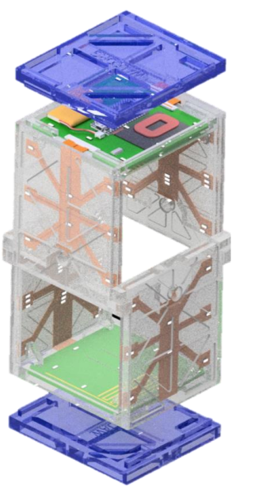
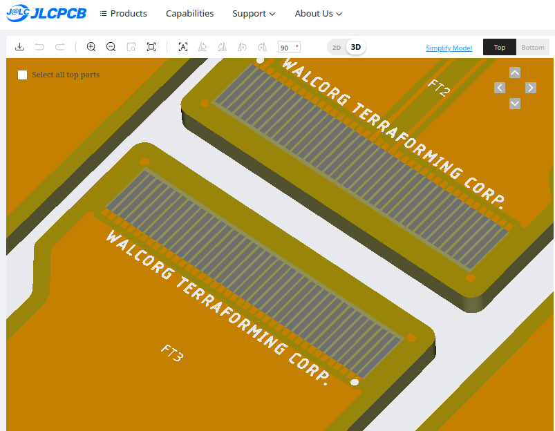
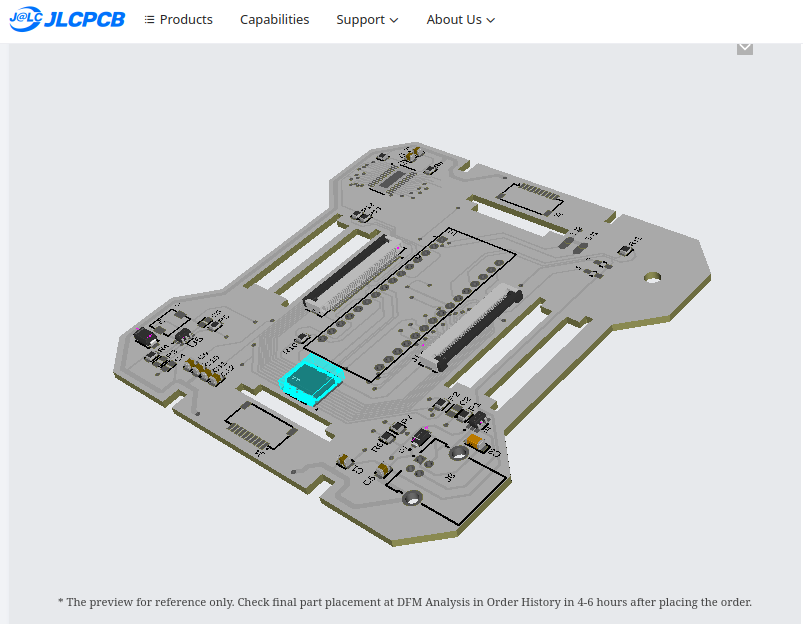

# node-routine

Firmware unificado para el Arduino Nano del **nodo v4.5** de **WALCORG TERRAFORMING CORP.**: control de LEDs (TLC59401), lectura de 16 sensores de luz, desinfección UVC y protocolo esclavo I2C hacia Clorela-OS.

<p align="center">
  
</p>

## Contenido

| Ruta | Descripción |
|---|---|
| [`firmware/walcorg_nodo_v45/walcorg_nodo_v45.ino`](firmware/walcorg_nodo_v45/walcorg_nodo_v45.ino) | Sketch único para el Arduino Nano (ATmega328P) de la PCB rígida |
| [`host/nodo_i2c_ejemplo.py`](host/nodo_i2c_ejemplo.py) | Ejemplo de maestro I2C en Python para la Raspberry Pi Zero W (shield) |
| [`docs/img/`](docs/img) | Imágenes del nodo, la flex, la PCB rígida, el shield y la caja del kit |

## Arquitectura

```
Raspberry Pi Zero W + shield (Clorela-OS)
        │  USB-B: +5 V (PTC 500 mA) + I2C 100 kHz (SDA = D-, SCL = D+)
        ▼
PCB rígida v4.5 ── Arduino Nano (esclavo I2C 0x10–0x13)
        │            ├─ TLC59401: 12 LEDs visibles + 4 LEDs UVC
        │            ├─ CD74HC4067: 16 sensores de luz → A0
        │            └─ MT3608: +V_UV (9 V) para los UVC
        ▼  J1 / J2 (FPC 40 pines, 0.5 mm)
PCB flexible ── LEDs, sensores y EEPROM de identificación en las paredes del cubo (1 L)
```

| | |
|---|---|
|  |  |
| PCB flexible: colas FPC hacia J1 y J2 | PCB rígida con el Arduino Nano |
|  |  |
| Shield para la Raspberry Pi Zero W, que gobierna uno o varios nodos | Caja del kit de ensamble del nodo |

## Mapa de canales

| TLC59401 | Uso | CD74HC4067 | Uso |
|---|---|---|---|
| 0–7 | LEDs de datos (1 bit c/u, LSB = canal 0) | 0–7 | SENS_B0–B7, retrodispersión (J1) |
| 8–11 | LEDs de calibración | 8–15 | SENS_T0–T7, transmisión (J2) |
| 12–15 | LEDs UVC (275 nm) | | |

## Compilar y cargar

1. Arduino IDE, placa **Arduino Nano**, procesador **ATmega328P**.
2. Instala la biblioteca **Tlc5940** (Gestor de bibliotecas, o [PaulStoffregen/Tlc5940](https://github.com/PaulStoffregen/Tlc5940)). Su configuración por defecto coincide con los pines de la placa.
3. Si el Nano usa el bootloader antiguo («ATmega328P (Old Bootloader)»), pon `USE_WATCHDOG 0` en el sketch.

Uso de memoria: ~8 KB de flash (25 %) y ~1 KB de RAM (51 %).

## Protocolo I2C

Dirección: `0x10 + ADDR1·2 + ADDR0` (solder jumpers SJ1/SJ2; cerrado = 1).

- El maestro escribe `[comando, argumentos…]` (máximo 32 bytes).
- Una lectura después de un comando devuelve **8 bytes de estado**: `[estado, banderas, último_cmd, error, versión_fw, uv_seg_L, uv_seg_H, dirección]`.
- `R, página` prepara una página de **datos** (16 valores `uint16` little-endian): 0 = última medición, 1 = oscuridad, 2–13 = LED 0–11 encendido solo, 14 = configuración.

| Comando | Acción |
|---|---|
| `G` | Verifica oscuridad (bandera DARK_ALERT si algún sensor > umbral) |
| `H, n` | Enciende solo el LED n (0–11), mide y lo apaga |
| `K, byte` | Muestra el byte en los LEDs 0–7, mide y deja el patrón |
| `M, maskL, maskH` | Enciende los LEDs visibles de la máscara (12 bits) |
| `S` / `O` | Mide con los LEDs actuales / apaga los LEDs visibles |
| `B, vL, vH, texto` | Reproduce texto en los LEDs 0–7 (v = ms por carácter) |
| `C` | Calibración completa (páginas 1–13) |
| `E [, sL, sH]` | Desinfección UVC (300 s por defecto, máximo 1800 s) |
| `F` | Detiene la desinfección UVC |
| `D` | Modo seguro: apaga todo de inmediato |
| `L, r` | Rango de medición: 0 normal, 1 sensible |
| `P, id, vL, vH` | Parámetros: 0 estabilización (ms), 1 umbral de oscuridad, 2 intensidad visible, 3 intensidad UVC, 4 muestras, 5 duración UVC por defecto |

El detalle completo está en el encabezado del sketch.

## Seguridad UVC

> ⚠️ Los LEDs UVC (275 nm) dañan ojos y piel. Úsalos solo con el nodo vacío (entre cultivos) y la tapa cerrada.

- Duración máxima de 30 min, fija en el firmware.
- Al encender el UVC se apagan los LEDs visibles (presupuesto de corriente del USB).
- Con el UVC activo solo se aceptan `F` y `D`, que interrumpen cualquier operación en curso.
- Watchdog de 2 s: si el firmware se cuelga, el Nano se reinicia con el UVC y el elevador apagados.

## Pendiente

- Corrección de puntos por canal (VPRG en D12; requiere ajustar la biblioteca Tlc5940).
- Actualización de firmware por I2C (twiboot).
- Lectura de la EEPROM de identificación de la flex (0x50).
